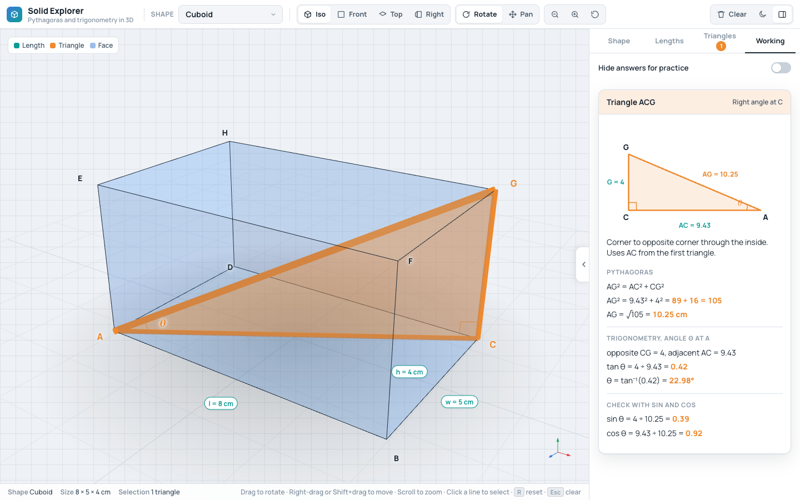
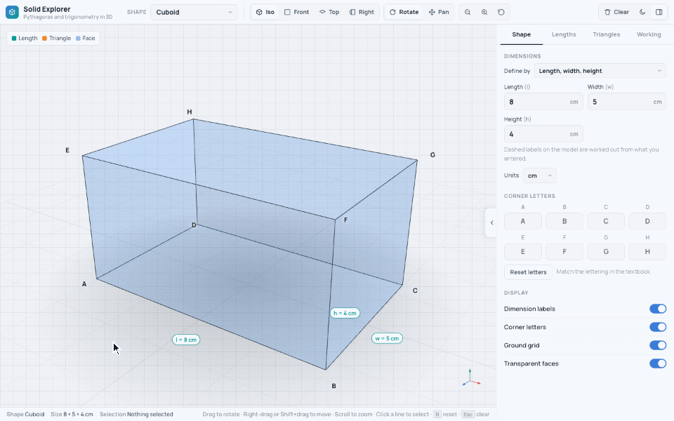

# Solid Explorer

**Pythagoras' theorem and trigonometry in 3D.**

Solid Explorer is a free teaching tool for the right-angled triangles hidden inside solid shapes. Pick a solid, turn it round, and click its edges and diagonals to see their lengths. Then pick any of the right-angled triangles inside it to see it shaded in 3D, flattened to 2D, and worked through step by step. It runs in a web browser. There are no accounts, no adverts and no tracking, and the page makes no network requests once it has loaded.

<p align="center">
  <picture>
    <source media="(prefers-color-scheme: dark)" srcset="docs/screenshots/hero-dark.png">
    
  </picture>
</p>

## Use it

There are three ways. Pick the one that suits you.

### 1. Open the live site

Go to **<https://maliktaha9797.github.io/solid-explorer/>**. Nothing to install.

### 2. Download one file

Go to the [latest release](https://github.com/maliktaha9797/solid-explorer/releases/latest) and download the file called `solid-explorer-<version>.html`, for example `solid-explorer-1.0.0.html`. Double-click it and it opens in your browser. It works with no internet, because everything it needs, fonts included, is inside that one file. You can keep it on a memory stick or send it to a colleague.

### 3. Run it from the code

You need [Node.js](https://nodejs.org/) 22 or newer.

```bash
git clone https://github.com/maliktaha9797/solid-explorer.git
cd solid-explorer
npm install
npm run dev
```

Open the address it prints. `npm run build` makes the single file, at `dist/index.html`.

## What it does



- **Seven solids:** cuboid, cube, square pyramid, rectangular pyramid, triangular prism, cone and cylinder.
- **27 ways to define them.** The **Define by** menu matches the way a textbook gives the lengths. A cuboid can be set by its length, width and space diagonal. A cone can be set by its radius and slant height. A square pyramid can be set by its base and the angle of its faces. If the lengths cannot make a solid, a message says what must be true, and the last good solid stays on screen.
- **Lengths, in your units:** centimetres, millimetres, metres, or plain units. Numbers you type show as solid labels on the model. Numbers the app works out show as dashed labels.
- **Corner letters you choose.** Rename the corners to match your textbook, and the labels on the model, the triangle titles and notes, and every line of working follow. The field names in the **Define by** section, such as "Slant height VP", keep the original letters.
- **Pick any edge or diagonal,** by clicking it on the model or from the lists. Hover over a line to see its length.
- **20 right-angled triangles** across the seven solids. Pick one and it is shaded inside the solid, with the right angle marked and the angle you are finding labelled θ. The **Working** tab flattens it and shows the steps: Pythagoras for the side, then the angle with tan⁻¹, then a check with sin and cos.
- **Hide answers for practice.** Every answer in the working becomes a `?`, including the ones inside √ and tan⁻¹. Students do the sum, then you switch it off to check.
- **Views and controls:** Iso, Front, Top and Right views. Rotate with a spin that carries on after a flick, move, and zoom by mouse, keyboard or touch.
- **Light and dark.** It follows your device until you choose, and remembers your choice.
- **It remembers** the shape, the units, the theme and whether the panel is open. It does not save the numbers you type, so a reload starts from the defaults.

## For teachers

To set a problem from a textbook:

1. **Pick the shape.** Use the Shape menu at the top left. Say you want a square pyramid.
2. **Say how it is defined.** Open the **Shape** tab, choose **Define by**, and pick the lengths the question gives you, for example "Base and slant height". Type the numbers and choose the units.
3. **Rename the corners.** In **Corner letters**, type the letters the textbook uses. **Reset letters** puts them back.
4. **Find the triangle.** Open the **Triangles** tab. It lists every right-angled triangle in the solid. Pick the one the question is about. It is shaded in the solid and the **Working** tab opens. Pick it again to put it away.
5. **Practise.** In the **Working** tab, switch on **Hide answers for practice**. The sums stay, and the answers become `?`. Students work them out, and you switch it off to check.

Two tips for a lesson. The small arrow on the edge of the panel, or the `]` key, hides the panel so the solid fills the screen. The Lengths tab lists every edge and diagonal with its length, so you can pick several at once.

## Controls

| To do this              | Do this                                                                                                           |
| ----------------------- | ----------------------------------------------------------------------------------------------------------------- |
| Rotate                  | Drag with the left mouse button, or with one finger. A quick flick keeps it spinning. Pressing stops it.          |
| Move the solid          | Drag with the right mouse button, or hold `Shift` and drag, or choose the **Pan** tool, or drag with two fingers. |
| Zoom                    | Scroll the mouse wheel, pinch with two fingers, press `+` or `-`, or use the zoom buttons.                        |
| Pick a line             | Click or tap it. Click it again to put it away.                                                                   |
| See a length            | Hover over a line with the mouse.                                                                                 |
| Iso view                | Double-click the model, or press `1` or `R`, or use the Reset button.                                             |
| Front, Top, Right view  | Press `2`, `3` or `4`, or use the buttons.                                                                        |
| Clear everything picked | Press `Esc`, or use **Clear**.                                                                                    |
| Show or hide the panel  | Press `]` or `[`, or use the panel button, or the arrow on the panel's edge.                                      |
| Dark mode               | Use the moon button.                                                                                              |

The keys do nothing while you are typing in a box.

## What has been tested

Be clear about this before you rely on it in a lesson.

- **Tested:** Chrome on a Mac, at desktop width and at 390 pixels wide, both on the development server and on the single `index.html` opened from disk. The tests were run by scripts, with the 3D drawn by software rather than a graphics card. Versions 1.0.0 and 1.0.1 were only checked on a normal display, and a Retina screen (a pixel ratio of 2) showed the 3D view twice as big and out of place. That is fixed from 1.0.2. The scripts now check both a pixel ratio of 1 and of 2, using Chrome's emulation of a 2x display. Version 1.0.2 was also opened on a real 2x display with a real graphics card (the browser pane of a desktop app, on a Mac with an Apple M4 Pro chip). There the solid lined up with its labels, the axis arrows showed, and the zoom stayed put when the theme changed. That was a short look, not a run of the whole checklist. The behaviour was checked item by item against the original single-file prototype that this project was made from, except where the changelog says it was changed. The checklist is in [`docs/parity-checklist.md`](docs/parity-checklist.md). The record of that run is kept by the maintainer and is not in this repository.
- **Not tested:** Safari and Firefox. They may well work, but nobody has checked.
- **Touch** was tested with emulated touch events only, not on a real phone or tablet.
- **The maths** has automatic tests: every shape, every Define by mode, the triangle solver and the number formatting.

## Known limits

- On a screen about the width of a phone, the toolbar runs off the right edge, so the page is wider than the screen. The original prototype did the same. The side panel does become a sheet at the bottom.
- Typing a new size or choosing another shape puts the zoom back to the starting distance. Your rotation stays, and so does your zoom when you do anything else.
- The keyboard shortcuts do not look for `Ctrl` or `Cmd`, so `Ctrl+R` (reload) also resets the view.

## Add a shape or a way to define one

New shapes and new Define by modes are plain data with tests, and each has a guide with a worked example that the tests run:

- [Adding a shape](docs/adding-a-shape.md), with a square frustum as the example
- [Adding a "Define by" mode](docs/adding-a-define-by-mode.md), with a cone defined by its diameter and slant height as the example

See [CONTRIBUTING.md](CONTRIBUTING.md) for how to set up and what we ask for in a pull request. Please read the [Code of Conduct](CODE_OF_CONDUCT.md) too.

## Licence and credits

Solid Explorer is released under the [MIT licence](LICENSE). Copyright (c) 2026 Taha Malik.

The single file includes [three.js](https://threejs.org/) (MIT) and the [Manrope](https://github.com/sharanda/manrope) font (SIL Open Font License 1.1, in `src/styles/fonts/OFL.txt`).
