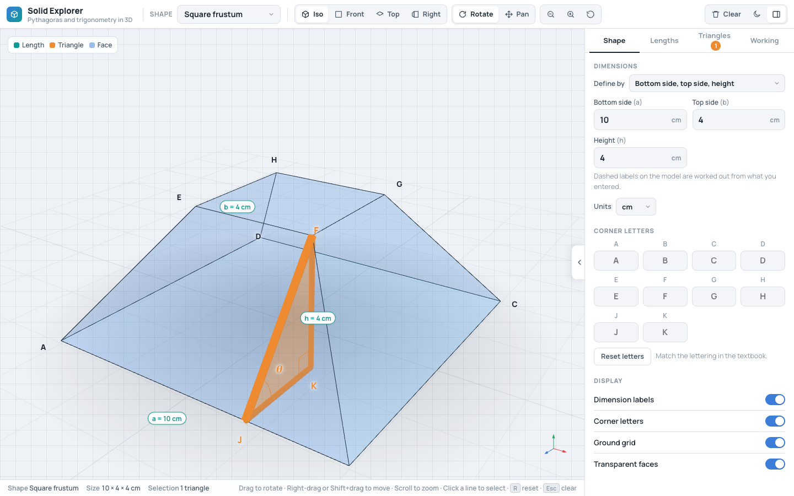

# Adding a shape

A shape in Solid Explorer is a plain object: a name, a list of dimensions, and a function called `build()` that turns those dimensions into points, faces and right-angled triangles. It never imports three.js and never touches the page, so it can be tested in milliseconds. The app turns that data into the 3D view, the panel and the working.

This page adds a **square frustum** (a square pyramid with its top sliced off) from start to finish. It is on the list of shapes to add after version 1.0, and it shows every part of the contract.

The code on this page is real. `tests/docs-examples.test.js` runs it, and fails if the code in this page and the code in `docs/examples/` ever differ. The frustum is not in the app: it lives in `docs/examples/` so that the app is unchanged. To add a shape for real, follow the same steps and put the code where this page says.



_The frustum once it is added, in a scratch copy of the app. It is not in the shipped app._

## Before you write code

Decide these first:

- **The registry key.** A short lowercase word such as `frustum`. It is saved in the browser as `se:shape` when a student picks the shape, so it is **permanent**. Never rename a key once it has shipped.
- **The name** in the Shape menu: "Square frustum".
- **The dimensions.** For each one, a key, a label and a default. The frustum has three: `a` (bottom side), `b` (top side) and `h` (height).
- **The vertex letters.** Single capital letters, one for each named point.
- **The right-angled triangles** a student could meet in a textbook question about this solid.

If the solid has curved surfaces, read "Curved solids" at the end first.

## The rules of the page

- y is up, x is to the right and z is towards the viewer.
- Centre the solid on the origin. Boxes run from minus half to plus half of each dimension. Pyramids, cones and cylinders run from `y = -h/2` to `y = +h/2`, with the apex or top at the top. Labels are pushed outwards from the origin, so a solid that is not centred gets its labels in odd places.
- Reuse the letters of the shapes that are already there. `A B C D` is the bottom face with `A` at the front left, and `E F G H` is the top face above `A` to `D`. `V` is an apex, `O` is the centre of a base, and `M` is a midpoint.
- Write vertex names as one capital letter. They must not depend on the dimensions, because the Corner letters section builds the shape at its default dimensions to find them.

## What `build()` returns

| Field    | What it is                                                                                                                                                                    |
| -------- | ----------------------------------------------------------------------------------------------------------------------------------------------------------------------------- |
| `verts`  | `{ A: [x, y, z], ... }`. Every named point.                                                                                                                                   |
| `faces`  | `[['A', 'D', 'C', 'B'], ...]`. Polygon faces, with the corners in order and the face convex. The edges are worked out from these. Leave it out for a curved solid.            |
| `dashed` | `[['J', 'K'], ...]`. Hidden or construction lines, such as an axis or a height. They are drawn dashed and can be selected like edges.                                         |
| `dims`   | `[['A', 'B', 'a'], ...]`. Which line carries the label for each dimension: "a = 10 cm". That line must be drawn (an edge or a dashed line), and it must be exactly that long. |
| `tris`   | The right-angled triangles. See below.                                                                                                                                        |

Two more lists exist for curved solids, `edges` and `circles`, and are described at the end.

The app works out two more lists for you, and you never write them: `allEdges` (the solid edges, then the dashed lines) and `diags` (every other pair of points that are not the same point). They become the chips in the Lengths tab.

Every named point is a letter in the Corner letters section and a chip in the lists, so only add a point if a triangle needs it.

## The triangles

Each entry is `{ title, pts, note }`. **The right angle is always at `pts[1]`, and the angle of interest, θ, is always at `pts[0]`.** The Working tab draws the triangle flat with the right angle at the bottom left (`pts[1]`), θ at the bottom right (`pts[0]`) and `pts[2]` at the top left, and it does the sums from that order:

| Name       | Which side                                                |
| ---------- | --------------------------------------------------------- |
| adjacent   | `pts[0]` to `pts[1]`                                      |
| opposite   | `pts[1]` to `pts[2]`                                      |
| hypotenuse | `pts[0]` to `pts[2]`                                      |
| θ          | the angle whose opposite and adjacent sides are those two |

If you list the points in the order that reads best in the title, the picture and the sums go wrong. Choose `pts` by the rule, then write the title.

In titles and notes, write vertex letters in square brackets: `Slant height [JF]`. The app swaps in the student's own letters when they rename corners, and drops the brackets. A bare letter does not follow a rename. Write in the voice described under "Writing" in [CONTRIBUTING.md](../CONTRIBUTING.md#writing): short sentences, British spelling, and say where a length came from when an earlier triangle found it.

Triangles build on each other, so the order matters. The frustum's second note says "`[JF]` comes from the first triangle".

### The frustum's triangles

Two right-angled triangles are hidden in a frustum, and each needs a point that is not a corner.

- The **slant height** of a face. `F` is a corner of the top. `K` is the point on the base directly below it, and `J` is the point on the bottom edge `AB` level with it. Then `JKF` has its right angle at `K`, with `JK` along the base and `KF` straight up.
- The **slant edge** `BF`. Triangle `BJF` has its right angle at `J`, where the slant height `JF` meets the edge `AB`. It uses `JF` from the first triangle.

```text
  F                    F
  |\                   |\
  | \  JF              | \  BF
h |  \  slant height   |JF \  slant edge
  |   \                |   \
  K----J               J----B
  (a - b) ÷ 2          (a - b) ÷ 2
```

| Triangle     | `pts`   | Right angle | θ      | Adjacent           | Opposite | Hypotenuse |
| ------------ | ------- | ----------- | ------ | ------------------ | -------- | ---------- |
| Slant height | `J K F` | at `K`      | at `J` | `JK = (a - b) ÷ 2` | `KF = h` | `JF`       |
| Slant edge   | `B J F` | at `J`      | at `B` | `BJ = (a - b) ÷ 2` | `JF`     | `BF`       |

With the default sizes (a = 10, b = 4, h = 4) the first triangle is the famous 3, 4, 5 one, so `JF` is 5 and θ at `J` is 53.13°. The second has sides 3 and 5, so `BF` is 5.83 and θ at `B` is 59.04°.

## Step 1: Write the shape

Create `src/shapes/frustum.js`. Name the file in kebab-case and name the export after the registry key.

<!-- docs-example: docs/examples/frustum.js -->

```js
// A square-based frustum: a square pyramid with its top sliced off by a plane parallel to the base.
//
// This is the worked example in docs/adding-a-shape.md. It is not part of the app. It lives in
// docs/examples/ so that tests/docs-examples.test.js can run it and the docs cannot be wrong.
// In the app this object would be the whole of src/shapes/frustum.js.
//
// Vertices (y is up, and the solid is centred on the origin):
//   A B C D   the bottom square, side a, with A at the front left
//   E F G H   the top square, side b, with E above A, F above B, and so on
//   J         on the bottom edge AB, level with F, so that JF is at a right angle to AB
//   K         on the base, directly below F
export const frustum = {
  name: 'Square frustum',
  dims: [
    ['a', 'Bottom side', 10],
    ['b', 'Top side', 4],
    ['h', 'Height', 4],
  ],
  build({ a, b, h }) {
    const p = a / 2,
      q = b / 2,
      y = h / 2;
    return {
      verts: {
        A: [-p, -y, p],
        B: [p, -y, p],
        C: [p, -y, -p],
        D: [-p, -y, -p],
        E: [-q, y, q],
        F: [q, y, q],
        G: [q, y, -q],
        H: [-q, y, -q],
        J: [q, -y, p],
        K: [q, -y, q],
      },
      faces: [
        ['A', 'D', 'C', 'B'],
        ['E', 'F', 'G', 'H'],
        ['A', 'B', 'F', 'E'],
        ['B', 'C', 'G', 'F'],
        ['C', 'D', 'H', 'G'],
        ['D', 'A', 'E', 'H'],
      ],
      dashed: [
        ['J', 'K'],
        ['K', 'F'],
        ['J', 'F'],
      ],
      dims: [
        ['A', 'B', 'a'],
        ['E', 'F', 'b'],
        ['K', 'F', 'h'],
      ],
      tris: [
        {
          title: 'Slant height [JF]',
          pts: ['J', 'K', 'F'],
          note: '[K] is directly below [F], so [JK] is half the difference between the two sides. The angle at [J] is between the face and the base.',
        },
        {
          title: 'Slant edge [BF]',
          pts: ['B', 'J', 'F'],
          note: '[BJ] is half the difference between the two sides too. [JF] comes from the first triangle.',
        },
      ],
    };
  },
};
```

Things to notice:

- `p`, `q` and `y` are half of the bottom side, half of the top side and half of the height. Every point is built from them, which is what centres the solid.
- The six faces are the same six as the cuboid's. The first vertex of each face is the one the face is fanned out from when it is drawn, so each face must be convex.
- The dashed lines are the three sides of the first triangle. The second triangle reuses `JF`, and its other two sides are `BF`, which is an edge, and `BJ`, which lies along the edge `AB` and is in the Diagonals list.
- `dims` puts the labels on lines that are drawn. The height is labelled on `KF`, a dashed line, and `KF` is exactly `h` long.
- `build()` does not check that `a` is more than `b`. A mode does that, so by the time `build()` runs the numbers are good.

## Step 2: Write the first mode

Every shape has a list of ways to define it, called "Define by" modes. The first is the canonical one: it takes the shape's own dimensions and hands them back. Add it to `src/modes.js`, as a new `frustum` entry at the end of `MODES`, in the same order as in the registry.

A frustum only makes sense when the bottom is wider than the top, so this first mode checks that. This is the one place a first mode may refuse a value.

<!-- docs-example: docs/examples/frustum-modes.js -->

```js
// The first ("canonical") way to define the frustum, for docs/adding-a-shape.md.
//
// In the app this is the first entry of MODES.frustum in src/modes.js, where needGT already
// exists. It is repeated here so that this file can run on its own.

// Strict: equal is an error too. Chain with || so the first failing check wins.
const needGT = (big, small, msg) => (big <= small ? { error: msg } : null);

export const frustumModes = [
  {
    name: 'Bottom side, top side, height',
    inputs: [
      ['a', 'Bottom side', 10],
      ['b', 'Top side', 4],
      ['h', 'Height', 4],
    ],
    toCanon: (v) =>
      needGT(v.a, v.b, 'The bottom side must be longer than the top side.') || {
        a: v.a,
        b: v.b,
        h: v.h,
      },
  },
];
```

Other ways to define the frustum (by its slant height, say) are added later, one at a time, as in [adding a "Define by" mode](adding-a-define-by-mode.md).

## Step 3: Register the shape

In `src/shapes/index.js`, import the shape and add it to the **end** of `SHAPES`. The Shape menu follows the order of this object, so the end keeps the existing shapes where they are.

```js
import { frustum } from './frustum.js';

export const SHAPES = { cuboid, cube, sqpyramid, rectpyramid, prism, cone, cylinder, frustum };
```

`MODES` in `src/modes.js` must have the same keys in the same order, and a test checks it.

## Step 4: Update the tests

The tests in `tests/shapes.test.js` check every shape in a list called `KEYS`. Once a shape is in that list, the generic tests cover it. For each shape, at its defaults and at a second set of sizes, they check that:

- every vertex pair is exactly one of an edge, a dashed line or a diagonal, and no two points are the same point
- every `dims` and `tris` entry names real vertices, every dimension is labelled once, and every label is on a selectable line
- every triangle has a right angle at `pts[1]`, to within 0.01 of a degree
- every title and note uses `[AB]` tokens that name real vertices, and none has a dash
- the vertex names are the same at any size, and the solid is centred on the origin
- nothing under `src/shapes` imports three.js or uses the page

One more check is worth adding for your own shape: the line that carries each `dims` label should be exactly as long as the dimension. The generic tests do not check it. The test for the docs examples does, and it is a short loop to copy.

Here is what you add by hand.

### `tests/shapes.test.js`

**Add the key.** Add `'frustum'` to `KEYS`.

**Add a second set of sizes** to `SECOND_DIMS`. None of the sizes may be a default, and no two may be equal, so that a mix-up between two dimensions would show:

<!-- docs-check: second-dims -->

```js
  frustum: { a: 9, b: 3, h: 5 },
```

**Add what the shape should have** to `EXPECTED_COUNTS`. The frustum has 10 points, 12 solid edges and 3 dashed lines. That makes 15 selectable lines, and the other 30 of the 45 pairs of points are diagonals:

<!-- docs-check: counts -->

```js
  frustum: { verts: 10, solidEdges: 12, dashed: 3, allEdges: 15, diags: 30 },
```

**Add it to the three full lists.** Three tests spell out every shape in full: the names, the dimension keys and defaults, and the number of triangles. Add the frustum to each: the name `'Square frustum'`, the three dimensions as written in the shape, and `2` triangles.

### `tests/modes.test.js`

**Add the name and the count.** Add `frustum: ['Bottom side, top side, height']` to `EXPECTED_NAMES`, and change the test that says there are exactly 27 modes to say 28.

**Add a boundary row.** The test called "covers every mode that has a needGT or other validation" fails until the frustum's first mode has a row in `BOUNDARIES`. Equal is an error, and a little more is a solid:

<!-- docs-check: frustum-boundary-row -->

```js
  {
    where: 'frustum "Bottom side, top side, height"',
    shapeKey: 'frustum',
    idx: 0,
    error: 'The bottom side must be longer than the top side.',
    bad: [
      { a: 4, b: 4, h: 4 },
      { a: 3, b: 4, h: 4 },
    ],
    good: { a: 5, b: 4, h: 4 },
    expected: { a: 5, b: 4, h: 4 },
  },
```

**Give the frustum its own test numbers.** The test "returns its inputs unchanged" feeds every shape's first mode the numbers 1.5, 2.5, 3.5 and so on. For the frustum that means a bottom side of 1.5 and a top side of 2.5, which its rule rightly refuses. Above that test, add numbers that follow the rule:

<!-- docs-check: other-values -->

```js
// Values for a first mode that has a rule of its own (the frustum needs a to be more than b).
const OTHER = { frustum: { a: 3.5, b: 1.5, h: 2.5 } };
```

Then, in the test, replace the line that builds `other` with:

```js
const other = OTHER[shapeKey] ?? Object.fromEntries(first.inputs.map(([k], i) => [k, 1.5 + i]));
```

### Two more files

`tests/persistence.test.js` has two tests that use `'frustum'` as an example of a saved shape name that does not exist. Once it does exist they fail. Change that word to another, such as `'pentagon'`. This is a quirk of the frustum, not of every new shape.

`tests/reference-parity.test.js` compares the shapes and modes with the original prototype at test time, so it fails on any new shape by design. Before your first new shape or mode, retire it or turn it into a snapshot. The comment at the top of that file says what it does.

Then run `npm test`.

## Step 5: Look at it in the app

```bash
npm run dev
```

Pick **Square frustum** in the Shape menu. You should see:

- the solid with its three labels (`a = 10 cm`, `b = 4 cm`, `h = 4 cm`), and the dashed lines `JK`, `KF` and `JF`
- ten boxes in Corner letters: `A` to `H`, then `J` and `K`
- two cards in the Triangles tab. Selecting the first shades the triangle `JKF` with a right angle marker at `K` and θ at `J`, and opens the Working tab with `JF² = 3² + 4² = 9 + 16 = 25`, `JF = √25 = 5 cm` and `θ = tan⁻¹(1.33) = 53.13°`
- 15 chips under Edges and 30 under Diagonals and construction lines

Rename `J` to another letter in Corner letters, and check that the titles, notes, labels and working all follow.

Then run `npm run check`, and the parts of the parity checklist ([`docs/parity-checklist.md`](parity-checklist.md)) for shapes and selection.

## Curved solids

A solid with a curved surface has no `faces`. Instead `build()` returns a small descriptor, `curved: { kind: 'cone', r, h }`, and the scene builds the three.js geometry from it. The cone and the cylinder do this, and their files in `src/shapes/` show how. They also give `edges` (the solid lines of the outline, such as the two slanting sides of the cone) and `circles` (`[[y, r], ...]`, the circle outlines to draw at height `y`).

A new kind of curved solid also needs a change in `src/scene/model.js`, because that is where each kind is turned into geometry. Do not import three.js into the shape. Open an issue first if you want to add one.

## Common mistakes

| Mistake                                           | What goes wrong                                 | Do this instead                                                                   |
| ------------------------------------------------- | ----------------------------------------------- | --------------------------------------------------------------------------------- |
| `import { ConeGeometry } from 'three'` in a shape | The shape can no longer be tested on its own    | Return a descriptor such as `{ kind: 'cone', r, h }`                              |
| `pts` in the order that reads best                | The flat picture and the sums come out wrong    | `pts[1]` is the right angle and `pts[0]` is θ                                     |
| A bare letter in a note                           | A renamed corner is not followed                | Write `[AC]`                                                                      |
| A `dims` line that is not drawn                   | The label floats with no line                   | Use an edge or a dashed line                                                      |
| A solid that is not centred                       | Labels and the camera are off                   | Centre it on the origin                                                           |
| Two points in the same place                      | A selectable "diagonal" of zero length          | Keep every named point apart. The diagonals list skips pairs closer than 0.000001 |
| Renaming a registry key                           | A returning student's saved shape breaks        | Keys are permanent                                                                |
| Extra points "just in case"                       | More letters to rename and more chips to scroll | Add a point only when a triangle needs it                                         |

## Finishing off

- Add a line under **Added** in `CHANGELOG.md`.
- Add the shape to the list in `README.md`, and update the count of modes if the README gives one.
- Take a screenshot if you can, and check that nothing you wrote has an em dash and that the spelling is British.
